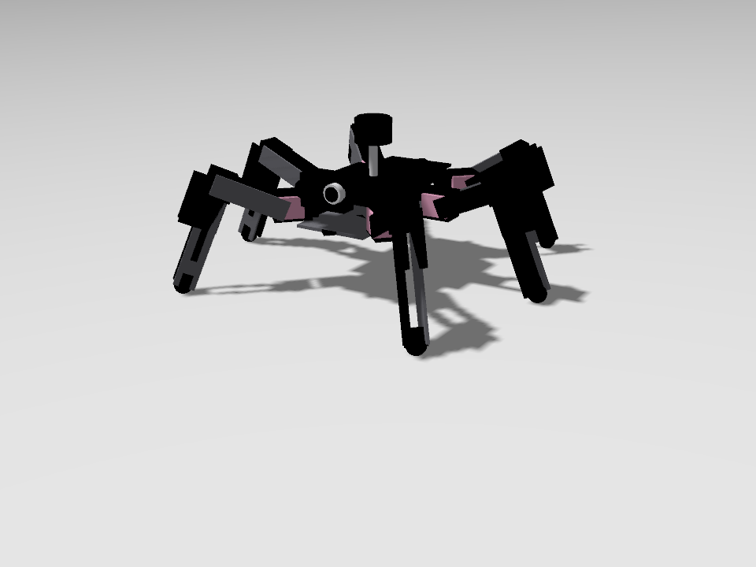

# Rescue swarm: autonomous victim search in a collapsed building

ROS 2 Humble + Gazebo Fortress. A team of three robots enters a procedurally generated
collapsed building. They split its rooms between them, map it, cross low debris, find
victims and drive back out, with no central controller:

- **visible** victims are found with a camera and YOLOv8, **buried** ones with a thermal camera;
- the robots share what they know over a range-limited radio;
- if one robot tips over or gets stuck, the others take over its rooms.

Two robots are developed side by side:

- the **wheel-leg robot** (default): four wheels on two rocker legs linked by a differential;
- the **hexapod**: an 18-DOF spider with a tripod gait.

A web mission control (http://localhost:8080) starts the whole search with one button,
shows every robot's cameras and the combined map, and lets you take over any robot or
drop new victims into the running world.

| Wheel-leg robot (`robot:=wheelleg`, default) | Hexapod (`robot:=hexapod`) |
|---|---|
|  |  |


**Contents:** [Quick start](#quick-start) · [The robots](#the-robots) ·
[Wheel-leg robot](#wheel-leg-robot) · [Hexapod](#hexapod) · [Results](#results) ·
[Mission control](#mission-control) · [How it works](#how-it-works) ·
[Testing](#testing) · [Setup details](#setup-details) · [Troubleshooting](#troubleshooting) ·
[Topics and frames](#topics-and-frames)

## Quick start

```bash
# once: victim models and YOLO (see Setup details)
ign fuel download -u "https://fuel.gazebosim.org/1.0/OpenRobotics/models/Rescue Randy"
ign fuel download -u "https://fuel.gazebosim.org/1.0/OpenRobotics/models/Rescue Randy Sitting"
pip install --user ultralytics "numpy<2"

cd ~/analog_project
source /opt/ros/humble/setup.bash
colcon build --symlink-install
source install/setup.bash

# three wheel-leg robots in a hard building
ros2 launch rescue_bringup mission.launch.py seed:=4 num_robots:=3 difficulty:=hard

# the same with hexapods
ros2 launch rescue_bringup mission.launch.py seed:=4 num_robots:=3 difficulty:=hard robot:=hexapod
```

Gazebo, RViz and **mission control** (http://localhost:8080) open. Press **Start all**.
The robots explore, report victims and come back by themselves. Stop with Ctrl+C.

Launch arguments:

| argument | default | |
|---|---|---|
| `robot` | `wheelleg` | `wheelleg`, `hexapod` or `rover` (see [The robots](#the-robots)) |
| `num_robots` | 1 | 1-3 |
| `seed` | 0 | building layout: same seed, same building and victims |
| `grid` | 4 | rooms per side (4 = 4x4 rooms, 24 x 20 m) |
| `difficulty` | normal | `hard`: 0.85 m doors, stepped debris, smoke, dark rooms |
| `victims_file` | | JSON with your own victims instead of the random ones |
| `auto_start` | false | start exploring without pressing Start |
| `time_limit` | 1200 | seconds; each robot heads home early enough to be out by then |
| `gui`, `rviz`, `dashboard` | true | Gazebo, RViz, web mission control |
| `port`, `open_browser` | 8080, true | mission control address; open a browser tab at start |
| `perception`, `swarm` | true | victim detector; radio + swarm agents |
| `radio_range`, `radio_wall_range` | 25, 8 | metres: line of sight, through walls |
| `evaluate` | false | score against ground truth, write a report, shut down |

Each robot's world only contains debris it can climb, so the same seed with a different
`robot` gives slightly different rubble (the world file is named `rescue_<seed>_c<cm>`).

## The robots

Everything that differs between the robots is kept in one file,
[robot_profiles.py](src/rescue_navigation/rescue_navigation/robot_profiles.py). That covers
footprint, speeds, climbable step height, sensor heights, and the navigation options
below. The launch files, Nav2 configuration, mapping, exploration and victim detection all
read from it.

| | Wheel-leg (default) | Hexapod | Rover |
|---|---|---|---|
| moves by | 4 wheels on 2 rocker legs, skid steer | 18 joints, tripod gait | 6 wheels, skid steer |
| footprint | 0.80 x 0.60 m (body 0.66 m long) | legs span ~0.53 x 0.58 m | 0.90 x 0.58 m |
| body height | 0.43 m (0.40-0.52 m adjustable) | 0.15 m | 0.14 m (axles) |
| cruise speed | 0.45 m/s | 0.35 m/s | 0.7 m/s |
| turning in place | 0.8 rad/s | 0.9 rad/s | yes (not measured) |
| sideways (crab) | no | yes | no |
| climbs | 10 cm blocks and joists | 12 cm blocks, 9 cm joists, 20 cm mounds | 12 cm steps |
| debris in its worlds | up to 9 cm | up to 12 cm | up to 12 cm |
| Gazebo plugin | `RescueWheelLegDrive` | `HexWalk` | Gazebo's `DiffDrive` |

The **rover** is a simple six-wheel fallback kept for comparison. It has no section of
its own.

## Wheel-leg robot


Modelled on the wheel-legged robot in *"Lateral Stability of a Mobile Robot Utilizing an
Active Suspension"* (MDPI). [URDF](src/rescue_description/urdf/wheelleg.urdf.xacro),
[drive plugin](src/rescue_hexabot/src/WheelLegDrive.cc).

**Mechanics**
- **Rocker V:** a red 0.66 m body has one *rocker* per side. A front and a rear leg form a
  V on a green hub that turns freely, with a 28 cm wheel at the foot of each leg.
- **Differential:** a bar links the two sides. When one rocker tips up the other tips
  down, so all four wheels stay on uneven ground and the body pitches only half as much.
- **One motor per side** opens or closes that side's V:
  - narrow stands tall (body 0.52 m up), wide crouches (0.40 m);
  - opening one side more than the other levels the body across a slope
    ([photo](docs/wheelleg_front_slope.png)).
- **Mission stance:** a fixed 0.8 rad. The wheels sit 0.52 m apart front to back and
  0.52 m side to side. Skid steering only turns in place while the wheelbase is no
  longer than the track, and the drive spins the wheels 1.8x faster when turning to make
  up for tyre scrub.

**Drive plugin (`RescueWheelLegDrive`)**
- Skid-steers the wheels from `cmd_vel`.
- Runs the differential, the stance and the levelling.
- `/rN/stance` (`std_msgs/Float64`, rad) changes the stance.
- Two guards:
  - **pitch:** past 20 deg it stops driving further in the tipping direction;
  - **roll:** past 11 deg it slows to a crawl and stops turning until the levelling has
    the body upright.

Gazebo Fortress quirks it works around (useful if you change it):
- A joint with any force or wrench command ignores velocity commands, so the
  differential is a velocity servo on the right rocker that mirrors the free left one.
- A joint that starts outside its limits stays locked.
- Torque-controlled wheels chatter, so the wheels are velocity-controlled.

**Navigation settings and why**

| setting | why |
|---|---|
| Costmap cost falls off gently (radius 1.0 m) | NavFn plans for a point. A steep fall-off made paths hug walls, and the corners of the 0.60 m body scraped door jambs. Now paths run down the middle. |
| `wall_guard` between Nav2 and the wheels | Last check from the 3D lidar (below). |
| 2D scan starts at 1.0 m | Teammates' camera heads reach ~0.85 m. Below that they got into the SLAM scan as walls. |
| Global costmap from `nav_map` only | Scan marks far from the robot are never cleared. A teammate caught in the scan once sealed the entrance for everyone's trip home. |
| Own path kept walkable 0.36 m wide, teammates cleared 0.9 m around | Ghosts of teammates in a doorway can't close the way back. |

**`wall_guard`** looks at the 3D lidar every control cycle:
- steers away from anything within 12 cm of a side, and towards the middle in a doorway;
- stops forward motion if something is right ahead;
- creeps clear of a corner it would hit while turning in place;
- backs off at once if it is pushing against something without moving.

The explorer's escape moves, Nav2 recoveries and teleop bypass it.

**Measured** (robot alone):
- 0.48 m/s straight, 0.8 rad/s turning in place;
- over 10 cm blocks and joists with no pitch;
- level across a 12 deg slope, and with one side up on an 8 cm plank;
- through 0.85 m doors.

**Limitations**
- 12 cm blocks stop it.
- Lifting the front wheels onto a step with the stance motors was tried and dropped,
  because the robot flipped too often. The code is still there, switched off
  (`climb_attempts 0`).
- It can still tip over beside a door jamb (see [Results](#results)).

**Driving it by hand:** `ros2 run rescue_navigation teleop`.
- Arrow keys drive.
- **1/2/3** selects the robot.
- **R/F** raises or lowers it.
- **+/-** changes speed; **Space** stops.

## Hexapod


An 18-DOF spider styled after hobby kits: black body plates and red servos, with a sensor
head at the front. Each leg has a coxa (yaw), a femur and a tibia (pitch), and all
joints are physically simulated. [URDF](src/rescue_description/urdf/hexabot.urdf.xacro),
[gait plugin](src/rescue_hexabot/src/HexWalk.cc).

**Gait plugin (`HexWalk`)**
- **Tripod gait** from `cmd_vel`, forward, sideways (crab) and turning:
  - two tripods alternate with a 55 % duty cycle, so both are briefly on the ground at
    each switch;
  - step frequency rises with speed (1-3 Hz), keeping the stride under 12 cm.
- **Each step:**
  - the foot lifts 11 cm straight up, swings, and drops straight down, so it clears
    edges instead of catching on them;
  - analytic inverse kinematics turns each foot target into joint angles;
  - each joint gets a velocity command, so the legs behave like torque-limited servos.
- **Terrain adaptation:**
  - **touch-down sensing:** a foot comes down until it actually touches something. A leg
    landing on a block holds that height instead of pushing the body up.
  - **body height** follows the feet on the ground, so the robot rises onto a block
    smoothly and comes back down after it.
  - **look-ahead:** before debris, from `terrain_ahead` in the traversability map, feet
    lift higher, the body rises and the gait slows.
  - **IMU levelling:** legs on the high side shorten and on the low side extend.
  - **climbing:** the gait slows down while the body is tilted.

**Navigation:** circular footprint (radius 0.22 m), holonomic, so it can crab-walk out
of tight spots. It uses the standard costmap settings with no `wall_guard`.

**Measured** (earlier version):
- 0.40 m/s cruise, 0.92 rad/s turning;
- climbs 12 cm blocks, 9 cm joists, gravel, and 20 cm mounds over 15 deg ramps, without
  flipping.

**Driving it by hand:** on the dashboard after **Take over**, **W/S/A/D** plus **Q/E** to
crab walk.

## Results

Scored by `rescue_eval` against the generator's ground truth. Every building has
4 visible and 2 buried victims plus one hot decoy (a fire that must be reported as a
hazard, never a victim). Laptop: i5-12500H and RTX 3050; YOLO takes ~15 ms per frame on
the GPU.

### Wheel-leg robot: hard 4x4 building

`grid:=4 difficulty:=hard`: 24 x 20 m, smoke, dark rooms, 0.85 m doors, stepped debris.
Three robots, 15 min limit, one run per seed:

| seed | victims found | false positives | mean error | floor explored | mission time | robots home |
|---|---|---|---|---|---|---|
| 2 | 5/6 (3/4 visible, 2/2 buried) | 0 | 0.26 m | 94 % | 14.8 min | 3/3 |
| 3 | 4/6 (2/4 visible, 2/2 buried) | 0 | 0.34 m | 82 % | 14.7 min | 3/3 |
| 4 | 5/6 (3/4 visible, 2/2 buried) | 0 | 0.36 m | 100 % | 14.2 min | 3/3 |

In these runs every robot came back before the time limit, none tipped over, and the hot
decoy was always reported as a hazard. Most misses are visible victims in rooms the team
hadn't finished when it was time to turn back.

Two later runs tested changes made after the table:

| run | victims | false positives | robots home | notes |
|---|---|---|---|---|
| seed 3, controller rides out late SLAM transforms | 5/6 | 0 | 2/3 | dropped paths 52/16/8 -> 0/0/1 per robot; one robot tipped over at a door jamb, and its teammates took its rooms |
| seed 4, rooms stay with their owner | 5/6 | 0 | 3/3 | 100 % explored in 11.1 min |

For the room-ownership change, time spent in their own rooms went from 0-34 % to 54-65 %
per robot.

### Hexapod (earlier version)

These are from before the room split, robot health and the navigation changes above.

Normal 3x3 buildings, three robots, 15 min limit:

| seed | victims found | false positives | floor explored | mission time | robots home |
|---|---|---|---|---|---|
| 1 | 5/6 (4/4 visible, 1/2 buried) | 1 | 100 % | 19.1 min* | 2/3 |
| 2 | 4/6 (2/4 visible, 2/2 buried) | 2 | 100 % | 10.5 min | 3/3 |
| 3 | 6/6 (4/4 visible, 2/2 buried) | 2 | 100 % | 7.2 min | 3/3 |
| 4 | 6/6 (4/4 visible, 2/2 buried) | 5 | 100 % | 17.0 min* | 2/3 |

Hard 4x4 building, seed 4, two runs: 6/6 victims each, 1 false positive, 0.31-0.38 m
mean error, 100 % explored, 1/3 robots home.

\* Hit the time limit while one robot was still walking home. The early, distance-based
return was added after these runs.

### Known limitations

- **Time:** the team turns back in time to be out by the limit, so in a large hard
  building some rooms stay unsearched.
- **Rubble:** robots still back away from rubble 10-40 times a mission.
- **GPU:** if it drops out (`CUDA unknown error`, typically after suspend), YOLO runs on
  the CPU, the simulation slows to ~0.3x real time and SLAM falls behind. See
  [Troubleshooting](#troubleshooting).
- **Distant sightings:** they are placed less accurately than close ones. A victim seen
  only from far away can be missed, and a buried victim with a limb showing may be
  reported as visible (and the reverse).
- **Variation:** results vary from run to run (physics, timing).

## Mission control

A web app served by the `dashboard` node (aiohttp + rclpy) at http://localhost:8080.
The robots are autonomous; everything here is optional.

- **Top bar:**
  - mission time, building explored, victims found, robots active;
  - **Start all / Stop all / Return all**;
  - **Save report** (`~/rescue_reports/mission_<time>.md`, with victim snapshots);
  - **Save scenario**.
- **Map:** all robots' maps combined in the building frame; drag, scroll, **Fit**.
  - Layers: map, trails, radio range, goals, victims, and **rooms** (tinted by owner,
    faint with ✓ once done).
  - Smoke and dark rooms are hatched.
  - Click a victim for its first-sighting snapshot; click a robot to select it.
- **Robot cards:** state, position, speed, distance, area explored, radio contact.
  - A red **DOWN** or orange **STUCK** badge appears when a robot can't search.
  - Buttons: start / stop / home / **Take over**.
- **Cameras:** every robot's RGB (with YOLO boxes) and thermal (false colour).
- **Victims** list, **charts** (coverage, victims, distance) and a **timeline** of events,
  including room hand-overs.

**Intervening.**
- **Take over** puts a robot in manual mode. Drive it with the on-screen joystick or the
  keyboard; it stops 0.4 s after the commands stop.
- **Send robot here** + a click on the map: Nav2 takes the robot there and it holds.
- **Resume autonomy** hands it back to its explorer.

**Placing victims.**
- **Place victim** (lying, sitting or buried) + a click on the map adds a victim to the
  running world and to the ground truth.
- **Save scenario** writes all victims to `~/rescue_reports/scenario_<time>.json`.
  Re-run the same setup with `victims_file:=<file>` and the same `seed`.
- You can also write the file by hand, in building coordinates: metres, origin at the
  bottom-left outer corner, entrance on the bottom wall.

```json
{"victims": [
  {"x": 3.0, "y": 2.5, "posture": "lying", "yaw": 30},
  {"x": 15.0, "y": 12.0, "posture": "sitting", "yaw": -90},
  {"x": 20.0, "y": 7.0, "buried": true}
]}
```

The page also works from another computer on your network (http://<this-pc>:8080).
Anyone who can open it can drive the robots.

## How it works

```
                 Gazebo Fortress (physics, 3D lidar, RGB + thermal cameras)
                                       │
   per robot rN ───────────────────────┼───────────────────────────────────────────────
   drive / gait plugin ◄─ cmd_vel ─ [wall_guard] ◄─ Nav2 (NavFn A*, Regulated Pure Pursuit)
   odometry (drifting)                                     ▲ nav_map
   SLAM Toolbox (2D) ── map ──► traversability ────────────┘ (height map + SLAM + geofence)
   explorer (frontiers, own rooms first) ◄── team/state ── swarm_agent ◄─► radio ◄─► teammates
   ──────────────────────────────────────────────────────────────────────────────────────
   shared: victim_detector (YOLOv8 + thermal + lidar placement)   radio channel
           dashboard   evaluator
```

| Package | What it does |
|---|---|
| `rescue_world` | Seeded building generator. Rooms, doors (some buried in rubble), breaches, climbable and blocking debris, Rescue Randy victims (some buried under warm debris) and a hot decoy. `hard` adds 0.85 m doors, stepped debris, smoke (blinds the RGB camera, not thermal or lidar) and dark rooms. Writes the SDF world and the ground truth. |
| `rescue_description` | Robot URDFs (wheel-leg, hexapod, rover), each with a 16-ring 3D lidar, RGB and thermal cameras and an IMU. |
| `rescue_hexabot` | Gazebo plugins `RescueWheelLegDrive` and `HexWalk`, the odometry node, and the localhost FastDDS profile. |
| `rescue_navigation` | `traversability`, `explorer`, `wall_guard`, SLAM/Nav2 configuration, `robot_profiles`, keyboard `teleop`. |
| `rescue_perception` | `victim_detector`: YOLOv8 persons and thermal body blobs, placed with lidar and the floor plane, fused into victims. |
| `rescue_swarm` | `radio` (simulated channel), `swarm_agent` (gossip), `rooms` (room split), `health` (ok / stuck / down). |
| `rescue_dashboard` | Web mission control. |
| `rescue_eval` | `evaluate` (scores one mission) and `run_batch` (many seeds headless). |
| `rescue_bringup` | `mission.launch.py` (everything) and `sim.launch.py` (world and robots only). |

### Mapping and navigation (per robot)

- **SLAM Toolbox** builds the wall map from a 2D scan cut out of the 3D cloud, and
  corrects odometry drift. The scan only uses a height band above the robots (from
  1.0 m for the wheel-leg robot, 0.4 m for the others), so teammates never become walls.
- **traversability** keeps a 10 cm height map from the 3D lidar and publishes `nav_map`:
  - walls, tall obstacles and steps higher than the robot can climb are lethal;
  - climbable steps get a cost, so paths prefer flat floor;
  - space SLAM saw as open but the lidar hasn't seen the floor of yet is "probably free";
  - outside the building is lethal, except near the start (geofence);
  - teammates are never obstacles, and the robot's own path stays walkable.
- **Nav2:**
  - NavFn A*, which may plan through unknown space;
  - Regulated Pure Pursuit, which rides out up to 1 s of late SLAM transforms instead of
    dropping the path;
  - spin and back-up recoveries;
  - the explorer configures and activates Nav2 itself and restarts it if bringup fails.
- **explorer:**
  - picks frontiers it can actually reach, scored by what it would reveal against the
    walking distance;
  - **own rooms first**, strictly; a teammate's room only when nothing else is left;
  - keeps away from teammates and their goals;
  - blacklists unreachable spots for 90 s and backs out when stuck;
  - turns back early enough to be home by the time limit.

### Victim detection

- **YOLOv8n** (COCO "person") on the RGB camera, on the GPU, one model shared by the team.
- **Thermal camera** (16-bit centi-kelvin):
  - blobs at 28-45 C are body heat, or debris warmed by a buried body;
  - above 52 C is a hazard (fire), never a victim.
- **Placement:**
  - the bottom of the detection box is where the body meets the floor;
  - the ray through it meets the floor plane, and lidar points at that distance refine
    the position;
  - teammates in view are rejected.
- **Fusion:**
  - **visible** = YOLO saw a person;
  - **buried** = body heat seen repeatedly from 2+ places with no person visible;
  - confidence grows with sightings and viewpoints.

### Swarm

No robot is in charge.

**Radio.** The `radio` node models the channel: robots hear each other within 25 m with
line of sight, or 8 m through walls. Each `swarm_agent` broadcasts its view of the team
once a second and merges what it hears, newest entry winning. News therefore travels
through teammates:
- positions, goals and mission states;
- a 0.5 m explored grid per robot;
- victims;
- the room book, each robot's health, and its open frontiers per room.

**Rooms.**
- **Initial split:** every robot computes the same split from the building plan without
  talking. Rooms are ordered by bearing from the entrance, left to right, and cut into
  one equal group per robot.
- **Ownership:** a room stays with its owner until it is handed over. Explorers take
  frontiers in their own rooms first; driving *through* other rooms is fine.
- **Done:** a room is done when 90 % of it has been seen by anyone **and** no robot
  reports an open frontier in it. Done is sticky: it doesn't reopen.
- **Helping out:** a robot whose rooms are all done takes the nearest half of the
  busiest teammate's unfinished rooms. To stop two idle robots passing the last room back
  and forth, it never takes:
  - the room that teammate is in or heading to;
  - from a teammate with only one room left;
  - a room that changed hands in the last minute.

**Robot health.** Each robot judges itself from its own sensors:
- **down:** tipped past 60 deg for 5 s. Its explorer stops.
- **stuck:** trying to move but stayed within 0.5 m for 2 min. It is ok again once it
  gets 1 m away.
- **ok:** otherwise.

Silence is not taken as failure; a robot out of range is usually just far away. A robot
that is down, stuck or stopped by the operator loses its unfinished rooms at once, each
to the healthy robot nearest to it.

## Testing

**Unit tests** (65: world 18, navigation 17, perception 9, swarm 19, eval 2):

```bash
source /opt/ros/humble/setup.bash
for p in rescue_world rescue_navigation rescue_perception rescue_swarm rescue_eval; do
  (cd src/$p && PYTEST_DISABLE_PLUGIN_AUTOLOAD=1 \
     PYTHONPATH=$PWD:../rescue_perception:../rescue_navigation:$PYTHONPATH python3 -m pytest -q test)
done
```

`PYTEST_DISABLE_PLUGIN_AUTOLOAD` works around a user-installed pytest 9 clashing with
ROS's launch_testing plugin.

**Scored missions**, headless, one per seed:

```bash
ARGS="difficulty:=hard" ros2 run rescue_eval run_batch 2 3 4                    # wheel-leg
ARGS="difficulty:=hard robot:=hexapod" ros2 run rescue_eval run_batch 2 3 4     # hexapod
```

`ROBOTS` (3) and `TIME_LIMIT` (900 s of mission time) can also be set. Each seed writes
`~/rescue_reports/seed<N>_<R>robots.md` (plus `.json` and the launch `.log`), and the
batch ends with `summary_<R>robots.md`. A report has:
- victims found per type, false positives and position error;
- hazard handling and floor coverage;
- mission time and robots back at the start;
- each robot's worst health, rooms at the end, and where it tipped over if it did.

A mission ends by itself once every robot is home. One mission takes 25-40 minutes of
real time, since the simulation runs at about 0.4x real time with everything on.

**By hand**, the checks worth doing after a change:
1. One robot (`num_robots:=1`): it explores and comes back.
2. Three robots with the **rooms** layer on: each mostly stays in its own tinted rooms,
   and owners change only on a hand-over (logged in the timeline).
3. **Stop** one robot early: its rooms go to the others straight away.
4. Wheel-leg robot with `teleop`: turning in place, the R/F stance, driving one side up
   onto debris.

## Setup details

- **ROS 2 Humble, Gazebo Fortress** with `ros-humble-ros-gz`, `slam-toolbox`,
  `navigation2`, `nav2-bringup`, `pointcloud-to-laserscan` and `xacro` (all apt packages).
- **Victim models:** the two `ign fuel download` commands put Rescue Randy in
  `~/.ignition/fuel`. Without them victims are built from simple shapes; thermal
  detection still works, but YOLO will rarely recognise them.
- **YOLO:** `pip install --user ultralytics "numpy<2"`. Keep NumPy 1.x, because ROS
  Humble's Python packages are built against it. The weights download to
  `~/.ros/rescue_models/` on first start. Without ultralytics the detector runs
  thermal-only.
- **DDS:** sourcing `install/setup.bash` points FastDDS at a localhost-only profile, so
  nodes find each other even on Wi-Fi that blocks multicast.

## Troubleshooting

- **Simulation much slower than usual, log says `CUDA initialization: CUDA unknown
  error`:** the NVIDIA driver lost its unified-memory module (typically after suspend),
  so YOLO runs on the CPU. Run `sudo rmmod nvidia_uvm && sudo modprobe nvidia_uvm`, or
  reboot. Then `python3 -c "import torch; print(torch.cuda.is_available())"` should print
  `True`.
- **Robots never start moving, and the log repeats `no rN/map -> rN/odom transform yet`
  or `Message Filter dropping message`:** a crashed run left stale shared memory. With
  nothing ROS running, run `fastdds shm clean`, then launch again.
- **Only some nodes see each other:** check that you sourced `install/setup.bash`,
  which sets the localhost FastDDS profile unless `FASTRTPS_DEFAULT_PROFILES_FILE` is
  already set.
- **Everything freezes when Wi-Fi drops:** Gazebo transport is pinned to loopback
  (`IGN_IP=127.0.0.1`) by the launch file for exactly this reason.
- **Mission control shows "address already in use":** another run is still up; pass
  `port:=8090`.
- **No cameras on the page:** they appear once Gazebo renders its first frames, 10-20 s
  after start.
- **RViz crashes from the VS Code terminal** (`undefined symbol __libc_pthread_init`):
  snap VS Code leaks GTK paths; the launch files remove them.
- **A hot laptop slows the simulation** until odometry arrives too late and a robot never
  starts. Let it cool down between long runs.

## Topics and frames

Per robot `rN`:

| Topic | |
|---|---|
| `/rN/cmd_vel` | drive command: `linear.x`, `angular.z` (`linear.y`: hexapod crab walk) |
| `/rN/cmd_vel_raw` | wheel-leg robot: Nav2's command before `wall_guard` |
| `/rN/stance` | wheel-leg robot: rocker V half-angle, rad (`std_msgs/Float64`) |
| `/rN/odom`, `/rN/odom/tilt` | drifting odometry; body roll and pitch |
| `/rN/lidar/points`, `/rN/scan` | 3D cloud; 2D scan cut from it above teammates' height |
| `/rN/camera/*`, `/rN/thermal/*`, `/rN/imu` | sensors |
| `/rN/map`, `/rN/nav_map` | SLAM map; fused navigation map |
| `/rN/mission/status` | explorer state (JSON, 1 Hz), including open frontiers per room |
| `/rN/mission/{start,stop,return_home}` | services (`std_srvs/Trigger`) |
| `/rN/mission/{takeover,resume}`, `/rN/mission/goto` | operator: manual mode and back; go to a `PointStamped` in `world` |
| `/rN/victims`, `/rN/victim_markers`, `/rN/perception/image` | detector output |
| `/rN/team/state` | swarm agent: teammates, room book, health, victims (JSON, 1 Hz) |
| `/rN/team/explored` | explored grid for RViz |
| `/rN/radio/{out,in}`, `/radio/links` | radio traffic; current links |
| `/rN/ground_truth/odom` | simulator pose, used only by the radio channel and the evaluator |
| `/scenario/ground_truth` | victims, including ones placed live (for the evaluator) |

TF chain:
- `world -> rN/map` (known start pose)
- `-> rN/odom -> rN/base_footprint` (level, at the ground)
- `-> rN/base_link` (body roll and pitch)
- `->` legs and sensors.
