# Rescue swarm: autonomous victim search in a collapsed building

ROS 2 Humble + Gazebo Fortress. A team of three wheel-leg robots enters a procedurally
generated collapsed building. They split its rooms between them, map it, cross low debris,
find victims and drive back out, with no central controller:

- **visible** victims are found with a camera and YOLOv8, **buried** ones with a thermal camera;
- the robots share what they know over a range-limited radio;
- if one robot tips over or gets stuck, the others take over its rooms.

A web mission control (http://localhost:8080) starts the whole search with one button,
shows every robot's cameras and the combined map, and lets you take over any robot or
drop new victims into the running world.

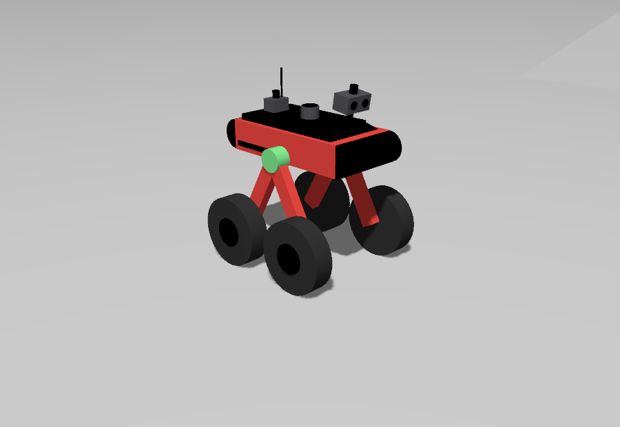

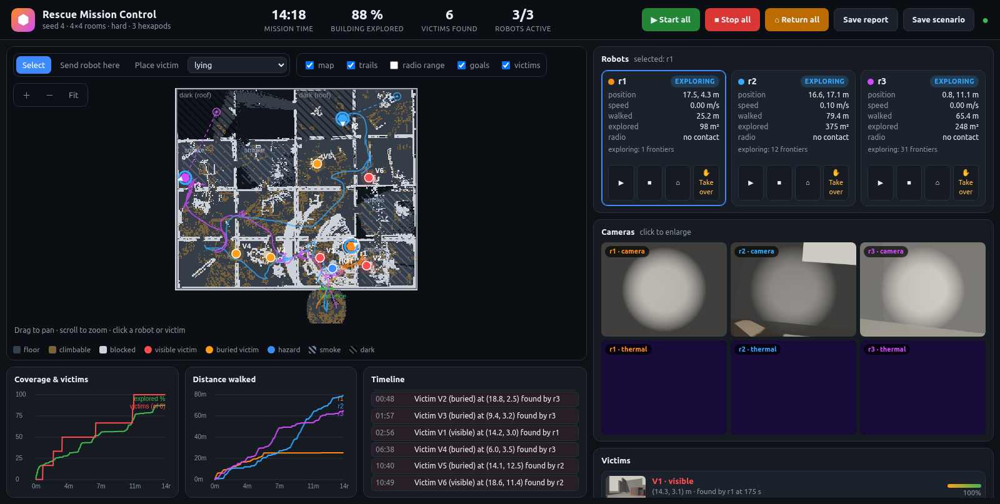

**Contents:** [Quick start](#quick-start) · [The robot](#the-robot) · [Results](#results) ·
[Mission control](#mission-control) · [Architecture](#architecture) ·
[How the code works](#how-the-code-works) · [Testing](#testing) ·
[Setup details](#setup-details) · [Troubleshooting](#troubleshooting) ·
[Topics and frames](#topics-and-frames) · [Issues faced](ISSUES_FACED.md)

## Quick start

```bash
# once: victim models and YOLO (see Setup details)
ign fuel download -u "https://fuel.gazebosim.org/1.0/OpenRobotics/models/Rescue Randy"
ign fuel download -u "https://fuel.gazebosim.org/1.0/OpenRobotics/models/Rescue Randy Sitting"
pip install --user ultralytics "numpy<2"

cd ~/analog_project
source /opt/ros/humble/setup.bash
colcon build --symlink-install
source install/setup.bash

# three robots in a hard building
ros2 launch rescue_bringup mission.launch.py seed:=4 num_robots:=3 difficulty:=hard
```

Gazebo, RViz and mission control (http://localhost:8080) open. Press **Start all**.
The robots explore, report victims and come back by themselves. Stop with Ctrl+C.

Launch arguments:

| argument | default | |
|---|---|---|
| `num_robots` | 1 | 1-3 |
| `seed` | 0 | building layout: same seed, same building and victims |
| `grid` | 4 | rooms per side (4 = 4x4 rooms, 24 x 20 m) |
| `difficulty` | normal | `hard`: 0.85 m doors, stepped debris, smoke, dark rooms |
| `victims_file` | | JSON with your own victims instead of the random ones |
| `auto_start` | false | start exploring without pressing Start |
| `time_limit` | 1200 | seconds; each robot heads home early enough to be out by then |
| `gui`, `rviz`, `dashboard` | true | Gazebo, RViz, web mission control |
| `port`, `open_browser` | 8080, true | mission control address; open a browser tab at start |
| `perception`, `swarm` | true | victim detector; radio + swarm agents |
| `radio_range`, `radio_wall_range` | 25, 8 | metres: line of sight, through walls |
| `evaluate` | false | score against ground truth, write a report, shut down |

## The robot

| tall stance | normal (mission) stance | low, wide stance | levelling on a 12° slope |
|---|---|---|---|
| 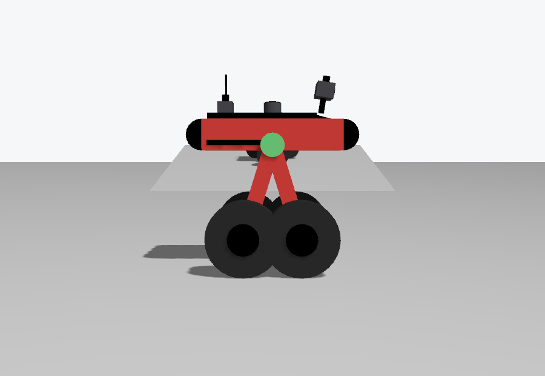 | 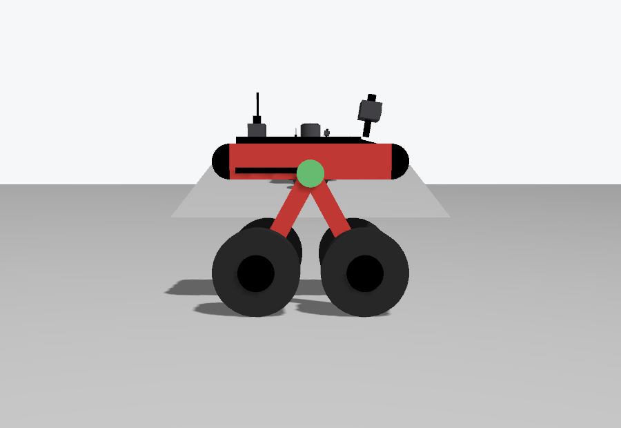 | 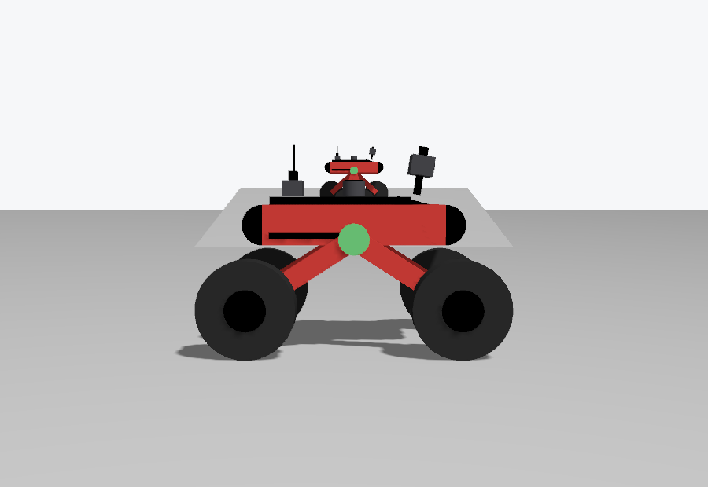 | 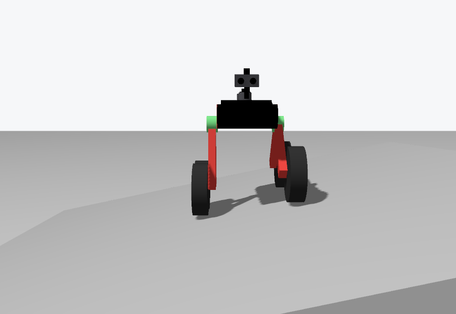 |

Modelled on the wheel-legged robot in *"Lateral Stability of a Mobile Robot Utilizing an
Active Suspension"* (MDPI). [URDF](src/rescue_description/urdf/wheelleg.urdf.xacro),
[drive plugin](src/rescue_wheelleg/src/WheelLegDrive.cc),
[dimensions and tuning](src/rescue_navigation/rescue_navigation/robot_config.py).

| | |
|---|---|
| moves by | 4 wheels on 2 rocker legs, skid steer |
| footprint | 0.80 x 0.60 m (body 0.66 m long) |
| body height | 0.43 m (0.40-0.52 m adjustable) |
| cruise speed | 0.45 m/s |
| turning in place | 0.8 rad/s |
| climbs | 10 cm blocks and joists |
| debris in its worlds | up to 9 cm |

[robot_config.py](src/rescue_navigation/rescue_navigation/robot_config.py) holds the
footprint, speeds, climbable step height, sensor heights and navigation options in one
place. The launch files, Nav2 configuration, mapping, exploration and victim detection
all read from it.

**Mechanics**
- **Rocker V:** a red 0.66 m body has one *rocker* per side. A front and a rear leg form a
  V on a green hub that turns freely, with a 28 cm wheel at the foot of each leg.
- **Differential:** a bar links the two sides. When one rocker tips up the other tips
  down, so all four wheels stay on uneven ground and the body pitches only half as much.
- **One motor per side** opens or closes that side's V:
  - narrow stands tall (body 0.52 m up), wide crouches (0.40 m);
  - opening one side more than the other levels the body across a slope.
- **Mission stance:** a fixed 0.8 rad. The wheels sit 0.52 m apart front to back and
  0.52 m side to side. Skid steering only turns in place while the wheelbase is no
  longer than the track, and the drive spins the wheels 1.8x faster when turning to make
  up for tyre scrub.

**Drive plugin (`RescueWheelLegDrive`)**
- Skid-steers the wheels from `cmd_vel`.
- Runs the differential, the stance and the levelling.
- `/rN/stance` (`std_msgs/Float64`, rad) changes the stance.
- Two guards:
  - **pitch:** past 20 deg it stops driving further in the tipping direction;
  - **roll:** past 11 deg it slows to a crawl and stops turning until the levelling has
    the body upright.

Gazebo Fortress quirks it works around (useful if you change it):
- A joint with any force or wrench command ignores velocity commands, so the
  differential is a velocity servo on the right rocker that mirrors the free left one.
- A joint that starts outside its limits stays locked.
- Torque-controlled wheels chatter, so the wheels are velocity-controlled.

**Navigation settings and why**

| setting | why |
|---|---|
| Costmap cost falls off gently (radius 1.0 m) | NavFn plans for a point. A steep fall-off made paths hug walls, and the corners of the 0.60 m body scraped door jambs. Now paths run down the middle. |
| `wall_guard` between Nav2 and the wheels | A last check from the 3D lidar before the wheels move (rules in [Navigation](#4-navigation-nav2--wall_guard)). |
| 2D scan starts at 1.0 m | Teammates' camera heads reach ~0.85 m. Below that they got into the SLAM scan as walls. |
| Global costmap from `nav_map` only | Scan marks far from the robot are never cleared. A teammate caught in the scan once sealed the entrance for everyone's trip home. |
| Own path kept walkable 0.36 m wide, teammates cleared 0.9 m around | Ghosts of teammates in a doorway can't close the way back. |

The explorer's escape moves, Nav2 recoveries and teleop bypass `wall_guard`.

**Measured** (robot alone):
- 0.48 m/s straight, 0.8 rad/s turning in place;
- over 10 cm blocks and joists with no pitch;
- level across a 12 deg slope, and with one side up on an 8 cm plank;
- through 0.85 m doors.

**Limitations**
- 12 cm blocks stop it.
- Lifting the front wheels onto a step with the stance motors was tried and dropped,
  because the robot flipped too often. The code is still there, switched off
  (`climb_attempts 0`).
- It can still tip over beside a door jamb (see [Results](#results)).

**Driving it by hand:** `ros2 run rescue_navigation teleop`.
- Arrow keys drive.
- **1/2/3** selects the robot.
- **R/F** raises or lowers it.
- **+/-** changes speed; **Space** stops.

## Results

Scored by `rescue_eval` against the generator's ground truth. Every building has
4 visible and 2 buried victims plus one hot decoy (a fire that must be reported as a
hazard, never a victim). Laptop: i5-12500H and RTX 3050; YOLO takes ~15 ms per frame on
the GPU.

`grid:=4 difficulty:=hard`: 24 x 20 m, smoke, dark rooms, 0.85 m doors, stepped debris.
Three robots, 15 min limit, one run per seed:

| seed | victims found | false positives | mean error | floor explored | mission time | robots home |
|---|---|---|---|---|---|---|
| 2 | 5/6 (3/4 visible, 2/2 buried) | 0 | 0.26 m | 94 % | 14.8 min | 3/3 |
| 3 | 4/6 (2/4 visible, 2/2 buried) | 0 | 0.34 m | 82 % | 14.7 min | 3/3 |
| 4 | 5/6 (3/4 visible, 2/2 buried) | 0 | 0.36 m | 100 % | 14.2 min | 3/3 |

In these runs every robot came back before the time limit, none tipped over, and the hot
decoy was always reported as a hazard. Most misses are visible victims in rooms the team
hadn't finished when it was time to turn back.

Two later runs tested changes made after the table:

| run | victims | false positives | robots home | notes |
|---|---|---|---|---|
| seed 3, controller rides out late SLAM transforms | 5/6 | 0 | 2/3 | dropped paths 52/16/8 -> 0/0/1 per robot; one robot tipped over at a door jamb, and its teammates took its rooms |
| seed 4, rooms stay with their owner | 5/6 | 0 | 3/3 | 100 % explored in 11.1 min |

For the room-ownership change, time spent in their own rooms went from 0-34 % to 54-65 %
per robot.

### Known limitations

- **Time:** the team turns back in time to be out by the limit, so in a large hard
  building some rooms stay unsearched.
- **Rubble:** robots still back away from rubble 10-40 times a mission.
- **Door jambs:** a robot can still tip over beside a jamb, typically during an escape
  move (those bypass `wall_guard`). Its teammates then take over its rooms.
- **GPU:** if it drops out (`CUDA unknown error`, typically after suspend), YOLO runs on
  the CPU, the simulation slows to ~0.3x real time and SLAM falls behind. See
  [Troubleshooting](#troubleshooting).
- **Distant sightings:** they are placed less accurately than close ones. A victim seen
  only from far away can be missed, and a buried victim with a limb showing may be
  reported as visible (and the reverse).
- **Variation:** results vary from run to run (physics, timing).

[ISSUES_FACED.md](ISSUES_FACED.md) lists the problems met during development and how each
was fixed.

## Mission control

A web app served by the `dashboard` node (aiohttp + rclpy) at http://localhost:8080.
The robots are autonomous; everything here is optional.

- **Top bar:**
  - mission time, building explored, victims found, robots active;
  - **Start all / Stop all / Return all**;
  - **Save report** (`~/rescue_reports/mission_<time>.md`, with victim snapshots);
  - **Save scenario**.
- **Map:** all robots' maps combined in the building frame; drag, scroll, **Fit**.
  - Layers: map, trails, radio range, goals, victims, and **rooms** (tinted by owner,
    faint with ✓ once done).
  - Smoke and dark rooms are hatched.
  - Click a victim for its first-sighting snapshot; click a robot to select it.
- **Robot cards:** state, position, speed, distance, area explored, radio contact.
  - A red **DOWN** or orange **STUCK** badge appears when a robot can't search.
  - Buttons: start / stop / home / **Take over**.
- **Cameras:** every robot's RGB (with YOLO boxes) and thermal (false colour).
- **Victims** list, **charts** (coverage, victims, distance) and a **timeline** of events,
  including room hand-overs.

**Intervening.**
- **Take over** puts a robot in manual mode. Drive it with the on-screen joystick or
  **W/S/A/D**; it stops 0.4 s after the commands stop.
- **Send robot here** + a click on the map: Nav2 takes the robot there and it holds.
- **Resume autonomy** hands it back to its explorer.

**Placing victims.**
- **Place victim** (lying, sitting or buried) + a click on the map adds a victim to the
  running world and to the ground truth.
- **Save scenario** writes all victims to `~/rescue_reports/scenario_<time>.json`.
  Re-run the same setup with `victims_file:=<file>` and the same `seed`.
- You can also write the file by hand, in building coordinates: metres, origin at the
  bottom-left outer corner, entrance on the bottom wall.

```json
{"victims": [
  {"x": 3.0, "y": 2.5, "posture": "lying", "yaw": 30},
  {"x": 15.0, "y": 12.0, "posture": "sitting", "yaw": -90},
  {"x": 20.0, "y": 7.0, "buried": true}
]}
```

The page also works from another computer on your network (http://<this-pc>:8080).
Anyone who can open it can drive the robots.

## Architecture

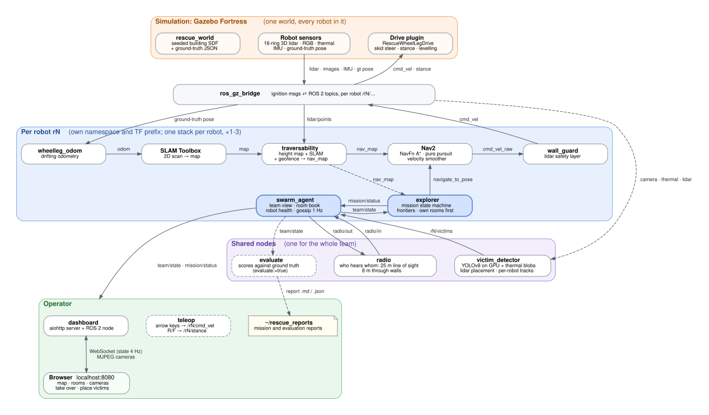

The system has four layers:

- **Simulation:** one Gazebo world holds every robot. Each robot's drive plugin moves
  its joints, and the `ros_gz_bridge` turns Gazebo messages into ROS 2 topics under
  `/rN/…`.
- **Per robot:** the blue box runs once for every robot, in its own namespace with its
  own TF prefix. Nothing in it talks to a teammate directly; everything a robot learns
  about the team comes through its `swarm_agent`.
- **Shared nodes:** these serve the whole team:
  - the victim detector (one YOLO model on the GPU, with separate outputs per robot);
  - the radio channel;
  - the evaluator.
- **Operator:** the web dashboard and keyboard teleop.

Dashed boxes are optional. The source of the picture is
[docs/architecture.dot](docs/architecture.dot).

| Package | What it does |
|---|---|
| `rescue_world` | Seeded building generator: rooms, doors, debris, victims, smoke and dark rooms. Writes the SDF world and the ground truth. |
| `rescue_description` | The robot's URDF, with a 16-ring 3D lidar, RGB and thermal cameras and an IMU. |
| `rescue_wheelleg` | Gazebo plugin `RescueWheelLegDrive`, the odometry node, and the localhost FastDDS profile. |
| `rescue_navigation` | `traversability`, `explorer`, `wall_guard`, SLAM/Nav2 configuration, `robot_config`, keyboard `teleop`. |
| `rescue_perception` | `victim_detector`: YOLOv8 persons and thermal body blobs, placed with lidar, fused into victims. |
| `rescue_swarm` | `radio` (simulated channel), `swarm_agent` (gossip), `rooms` (room split), `health` (ok / stuck / down). |
| `rescue_dashboard` | Web mission control. |
| `rescue_eval` | `evaluate` (scores one mission) and `run_batch` (many seeds headless). |
| `rescue_bringup` | `mission.launch.py` (everything) and `sim.launch.py` (world and robots only). |

## How the code works

### 1. World generation: `rescue_world/`

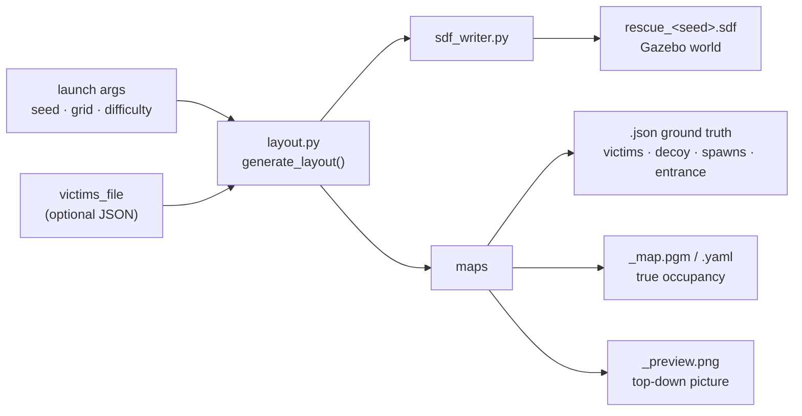

- **Same seed, same building.** The generator is pure geometry with no ROS, so it is fast
  and unit-tested.
- **Layout:**
  - the building is a grid of rooms with doors, some of them buried in rubble, and
    breaches in the walls;
  - debris comes in two kinds: **climbable** (low blocks, beams, gravel, ramped mounds)
    and **blocking** (walls, tall piles, slabs);
  - climbable debris is no higher than 9 cm, what the robot gets over reliably.
- **Victims:** Rescue Randy models lying or sitting; some are buried under warm debris.
  There is also one hot decoy, a fire.
- **`hard`** adds 0.85 m doors, stepped debris, smoke rooms (they blind the RGB camera,
  not thermal or lidar) and dark rooms under a collapsed roof.

| output | used by |
|---|---|
| `.sdf` | Gazebo |
| `.json` | robots get the building outline, entrance and start poses (the rescuers' plan); the radio, the dashboard and the evaluator get the rest |
| `_map.pgm` | the radio (line of sight) and the evaluator (free floor for coverage) |
| `_preview.png` | you |

### 2. Robot motion: `rescue_wheelleg/`

The plugin takes `/rN/cmd_vel` and `/rN/stance` and commands joint **velocities**.
Gazebo's physics moves the robot, so contacts, wheel slip and tipping come from the
simulation rather than from the plugin.

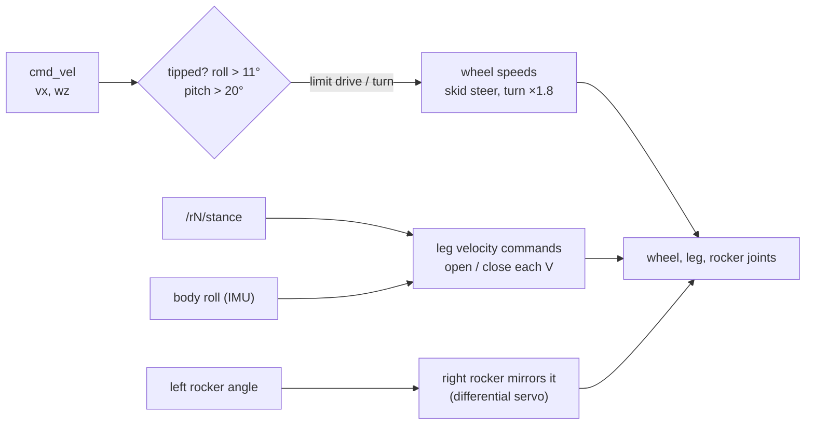

- Wheel speeds also make up for the legs moving: while a V opens, the wheels roll with
  it instead of pinning the feet.
- Levelling opens one side's V more than the other when the body rolls.
- **`wheelleg_odom`** turns the simulator's true pose into **drifting** odometry
  (`odom → base_footprint`) plus the body tilt (`base_footprint → base_link`). SLAM
  then has real drift to correct.

### 3. Mapping: `traversability`

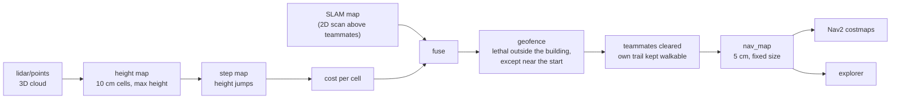

| `nav_map` value | meaning |
|---|---|
| 100 (lethal) | wall, anything taller than 40 cm, or the top of a step the robot can't climb |
| 20-70 | climbable step, costlier the taller it is, so paths prefer flat floor |
| 5 | "probably free": SLAM saw open space but no lidar ring has touched the floor yet |
| 0 | flat floor seen by the lidar |
| -1 | never seen |

The lidar can't see the floor right around the robot, but the robot is standing there,
so those cells are marked as floor. When the explorer reports it is stuck, the height
map forgets everything within the blind radius and lets it refill.

### 4. Navigation: Nav2 + `wall_guard`

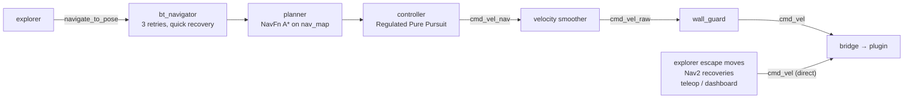

- **Startup:** the explorer configures and activates the Nav2 nodes itself, retrying
  until each one is up, and restarts them if bringup fails. There is no lifecycle
  manager.
- **Footprint:** the 0.80 x 0.60 m rectangle.
- **Late SLAM transforms:** the controller rides out up to 1 s of them instead of
  dropping the path.

| `wall_guard` sees (3D lidar, every cycle) | it does |
|---|---|
| something within 12 cm of one side | steers away from it and slows down |
| both sides close (a doorway) | steers towards the middle |
| something right ahead of the front edge | stops forward motion; turning still allowed |
| turning in place, a corner would hit something | creeps forward or back, away from it |
| pushing forward 2.5 s without moving | backs off for 1.2 s, turning away |

### 5. Exploration: `explorer`

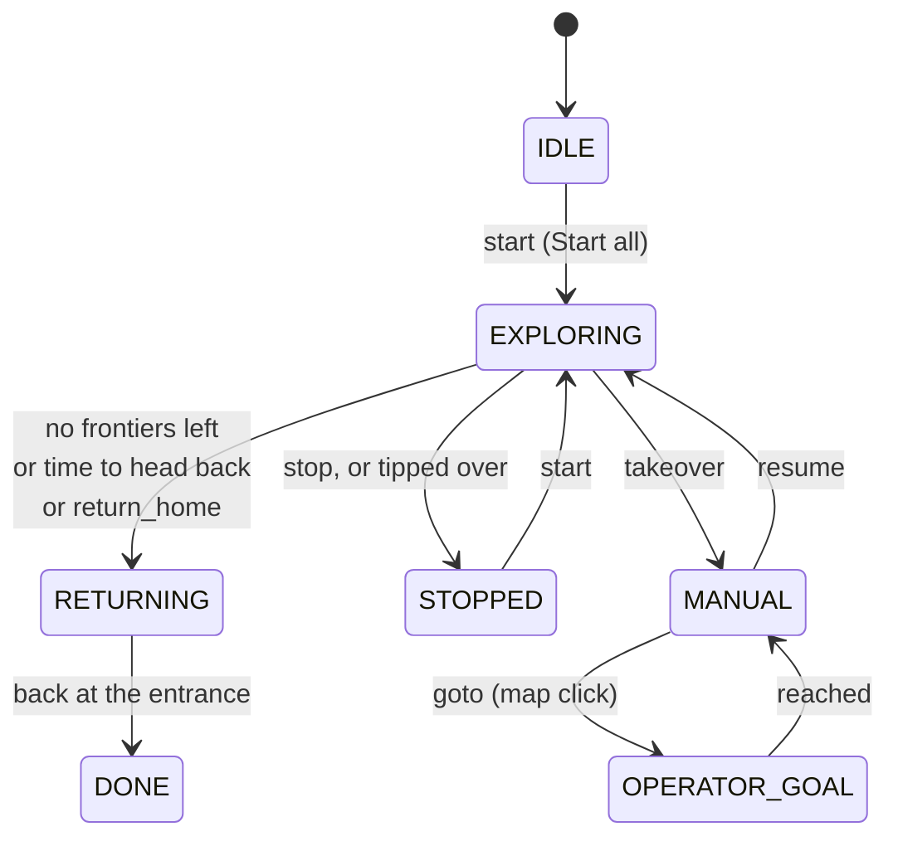

Each control step while exploring:

1. **Find frontiers:** walkable `nav_map` cells next to unknown ones, inside the
   building, that the robot can reach. Skip ones a teammate has already seen,
   blacklisted ones and ones underfoot.
2. **Score each frontier** by what it would reveal against the driving distance, minus a
   penalty near teammates and their goals.
3. **Own rooms first:** take the best frontier in its own rooms, or rooms nobody owns.
   Only if there are none, take one in a teammate's room.
4. **Fallback:** if its own map has no frontiers left, head for the edge of what *no
   one in the team* has seen.
5. **When stuck:**
   - a goal that makes no progress for a while is blacklisted for 90 s;
   - three quick failures in a row trigger an escape move: the robot drives straight
     out along its body, towards whichever side is clearer.
6. **Head home** when the remaining time is just enough to get back (distance home ×
   detour factor ÷ return speed + margin).

It publishes `mission/status` once a second: pose, goal, state, distance, area, and open
frontiers per room.

### 6. Victim detection: `victim_detector`

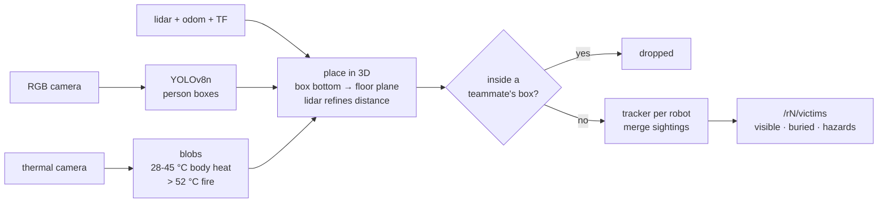

- **One process for the whole team:** three CUDA contexts would not fit next to Gazebo on
  a 4 GB GPU. Each robot still gets its own tracker and topics.
- **Kinds:**
  - **visible:** YOLO saw a person;
  - **buried:** body heat seen repeatedly from 2+ places with no person in view;
  - **hazard:** too hot to be a person (fire).
- **Confidence** grows with sightings and viewpoints. Weak "ghost" tracks next to a
  stronger one are folded into it.

### 7. Swarm: `rescue_swarm/`

One gossip round. Every agent does this once a second; here r1 is within range of r2:

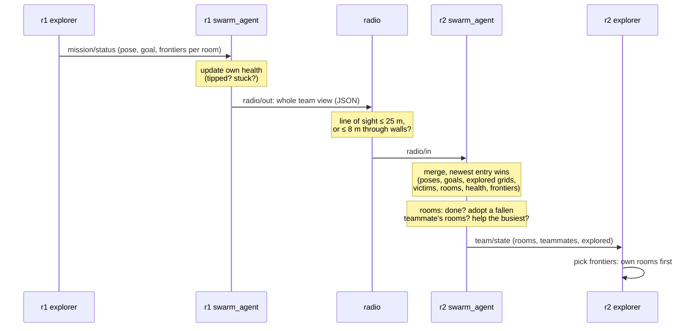

**What travels in a broadcast:**

| field | content | merged by |
|---|---|---|
| `poses`, `goals`, `states` | where each robot is, where it heads, mission state | newest per robot |
| `health` | ok / stuck / down | newest per robot |
| `frontiers` | open frontiers per room | newest per robot; ignored after 20 s |
| `explored` | 0.5 m grid per robot, base64 bit mask | OR |
| `victims`, `hazards` | confirmed tracks | tracker merge |
| `rooms` | room → [owner, time of last hand-over] | newest per room |

News reaches a robot out of range through any teammate that hears both.

**Who searches which room**, checked every round by each agent:

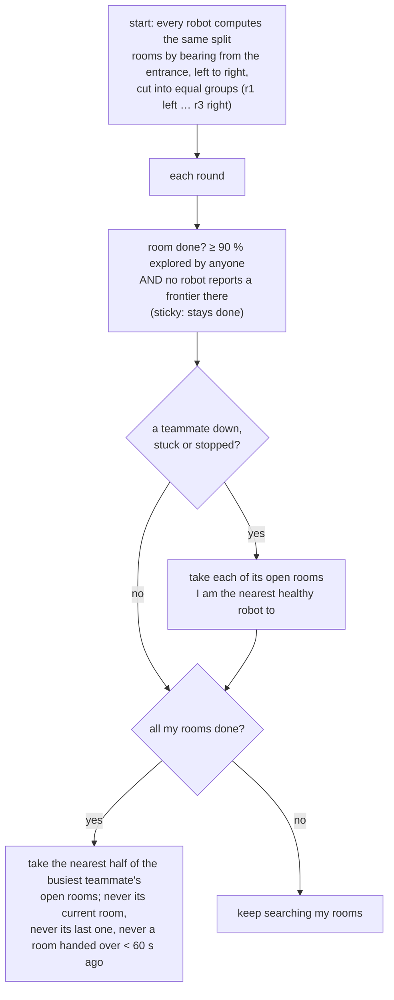

**Health** is judged by each robot about itself:
- **down:** tipped past 60° for 5 s. Its explorer then stops.
- **stuck:** less than 0.5 m of progress in 2 minutes while trying to move.

A robot that is only out of radio range is not marked down.

### 8. Mission control: `rescue_dashboard/`

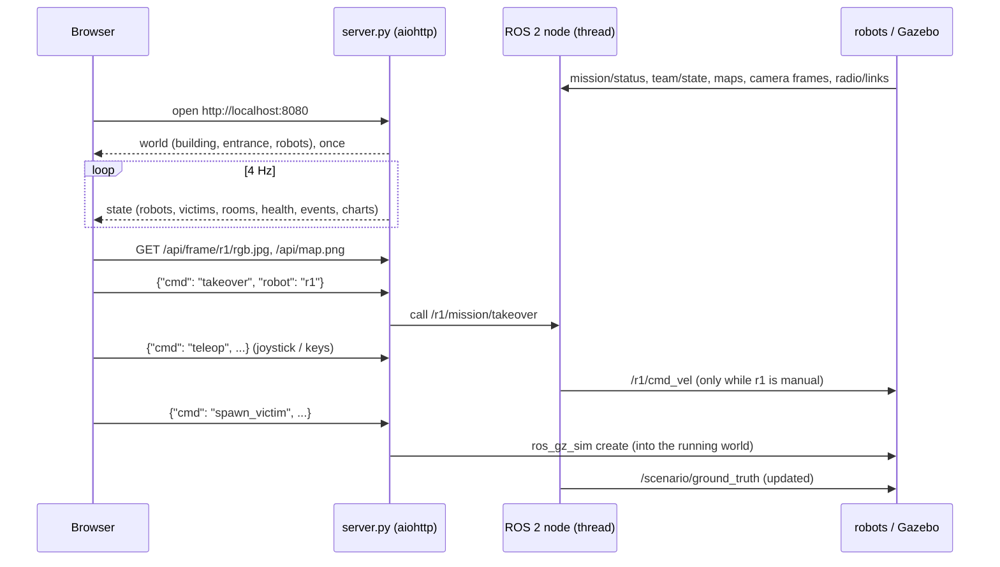

- Everything shown comes from the robots' own topics. The ground-truth file is read
  only for the building outline, entrance and start poses, as a rescue team would have.
- The **rooms** layer shows the newest owner per room across the robots' views.

### 9. Evaluation: `rescue_eval/`

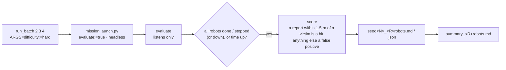

**What a report covers:**
- victims found per kind, false positives, position error, first-sighting time;
- hot decoys reported as hazards, or wrongly as victims;
- floor coverage: the share of free floor some robot explored;
- per robot: distance driven (ground truth), final state, whether back at the start,
  worst health, rooms at the end, and where it tipped over if it did.

## Testing

**Unit tests** (65: world 18, navigation 17, perception 9, swarm 19, eval 2):

```bash
source /opt/ros/humble/setup.bash
for p in rescue_world rescue_navigation rescue_perception rescue_swarm rescue_eval; do
  (cd src/$p && PYTEST_DISABLE_PLUGIN_AUTOLOAD=1 \
     PYTHONPATH=$PWD:../rescue_perception:../rescue_navigation:$PYTHONPATH python3 -m pytest -q test)
done
```

`PYTEST_DISABLE_PLUGIN_AUTOLOAD` works around a user-installed pytest 9 clashing with
ROS's launch_testing plugin.

**Scored missions**, headless, one per seed:

```bash
ARGS="difficulty:=hard" ros2 run rescue_eval run_batch 2 3 4
```

`ROBOTS` (3) and `TIME_LIMIT` (900 s of mission time) can also be set. Each seed writes
`~/rescue_reports/seed<N>_<R>robots.md` (plus `.json` and the launch `.log`), and the
batch ends with `summary_<R>robots.md`. A report has:
- victims found per type, false positives and position error;
- hazard handling and floor coverage;
- mission time and robots back at the start;
- each robot's worst health, rooms at the end, and where it tipped over if it did.

A mission ends by itself once every robot is home. One mission takes 25-40 minutes of
real time, since the simulation runs at about 0.4x real time with everything on.

**By hand**, the checks worth doing after a change:
1. One robot (`num_robots:=1`): it explores and comes back.
2. Three robots with the **rooms** layer on: each mostly stays in its own tinted rooms,
   and owners change only on a hand-over (logged in the timeline).
3. **Stop** one robot early: its rooms go to the others straight away.
4. `teleop`: turning in place, the R/F stance, driving one side up onto debris.

## Setup details

- **ROS 2 Humble, Gazebo Fortress** with `ros-humble-ros-gz`, `slam-toolbox`,
  `navigation2`, `nav2-bringup`, `pointcloud-to-laserscan` and `xacro` (all apt packages).
- **Victim models:** the two `ign fuel download` commands put Rescue Randy in
  `~/.ignition/fuel`. Without them victims are built from simple shapes; thermal
  detection still works, but YOLO will rarely recognise them.
- **YOLO:** `pip install --user ultralytics "numpy<2"`. Keep NumPy 1.x, because ROS
  Humble's Python packages are built against it. The weights download to
  `~/.ros/rescue_models/` on first start. Without ultralytics the detector runs
  thermal-only.
- **setuptools:** if a `pip install --user` pulls in a new setuptools, `colcon build`
  breaks; remove it so the system's setuptools 59.6 is used.
- **DDS:** sourcing `install/setup.bash` points FastDDS at a localhost-only profile, so
  nodes find each other even on Wi-Fi that blocks multicast.

## Troubleshooting

- **Simulation much slower than usual, log says `CUDA initialization: CUDA unknown
  error`:** the NVIDIA driver lost its unified-memory module (typically after suspend),
  so YOLO runs on the CPU. Run `sudo rmmod nvidia_uvm && sudo modprobe nvidia_uvm`, or
  reboot. Then `python3 -c "import torch; print(torch.cuda.is_available())"` should print
  `True`.
- **Robots never start moving, and the log repeats `no rN/map -> rN/odom transform yet`
  or `Message Filter dropping message`:** a crashed run left stale shared memory. With
  nothing ROS running, run `fastdds shm clean`, then launch again.
- **Only some nodes see each other:** check that you sourced `install/setup.bash`,
  which sets the localhost FastDDS profile unless `FASTRTPS_DEFAULT_PROFILES_FILE` is
  already set.
- **Everything freezes when Wi-Fi drops:** the launch file pins Gazebo transport to
  loopback (`IGN_IP=127.0.0.1`) to prevent this, unless `IGN_IP` is already set in your
  shell. Unset it and launch again.
- **Mission control shows "address already in use":** another run is still up; pass
  `port:=8090`.
- **No cameras on the page:** they appear once Gazebo renders its first frames, 10-20 s
  after start.
- **RViz crashes from the VS Code terminal** (`undefined symbol __libc_pthread_init`):
  snap VS Code leaks GTK paths; the launch files remove them.
- **A hot laptop slows the simulation** until odometry arrives too late and a robot never
  starts. Let it cool down between long runs.

## Topics and frames

Per robot `rN`:

| Topic | |
|---|---|
| `/rN/cmd_vel` | drive command: `linear.x`, `angular.z` |
| `/rN/cmd_vel_raw` | Nav2's command before `wall_guard` |
| `/rN/stance` | rocker V half-angle, rad (`std_msgs/Float64`) |
| `/rN/odom`, `/rN/odom/tilt` | drifting odometry; body roll and pitch |
| `/rN/lidar/points`, `/rN/scan` | 3D cloud; 2D scan cut from it above teammates' height |
| `/rN/camera/*`, `/rN/thermal/*`, `/rN/imu` | sensors |
| `/rN/map`, `/rN/nav_map` | SLAM map; fused navigation map |
| `/rN/mission/status` | explorer state (JSON, 1 Hz), including open frontiers per room |
| `/rN/mission/{start,stop,return_home}` | services (`std_srvs/Trigger`) |
| `/rN/mission/{takeover,resume}`, `/rN/mission/goto` | operator: manual mode and back; go to a `PointStamped` in `world` |
| `/rN/victims`, `/rN/victim_markers`, `/rN/perception/image` | detector output |
| `/rN/team/state` | swarm agent: teammates, room book, health, victims (JSON, 1 Hz) |
| `/rN/team/explored` | explored grid for RViz |
| `/rN/radio/{out,in}`, `/radio/links` | radio traffic; current links |
| `/rN/ground_truth/odom` | simulator pose, used only by the radio channel and the evaluator |
| `/scenario/ground_truth` | victims, including ones placed live (for the evaluator) |

TF chain:
- `world -> rN/map` (known start pose)
- `-> rN/odom -> rN/base_footprint` (level, at the ground)
- `-> rN/base_link` (body roll and pitch)
- `->` legs, wheels and sensors.

## Development history

`main` holds the final wheel-leg simulation. The
[`Testing`](https://github.com/Bhavarth257/Autonomous_swarm_bots/tree/Testing) branch keeps
the full step-by-step history, including the earlier RHex-style hexabot, the 18-DOF spider
hexapod and a six-wheel rover that were tried before this robot.
